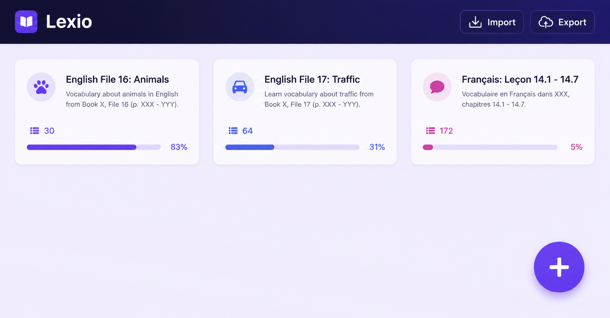

# Lexio

**Lexio** is a cross-platform desktop app for building vocabulary lessons and practicing them your way—flashcards, typing drills, multiple choice, synonym/antonym focus, or a simple word list. It runs on **Windows**, **macOS**, and **Linux**, stays entirely on your machine, and is **free** and **open source**.

---

## Highlights

| | |
|---|---|
| **Lessons** | Group words by topic, file, or language—each lesson tracks its own progress. |
| **Rich entries** | Terms, definitions, and optional synonyms and antonyms in one place. |
| **Learning modes** | Flashcards · Write · Multiple choice · Synonyms & antonyms · Vocabulary list |
| **Progress** | Correct and incorrect answers are remembered per mode so you see what still needs work. |
| **Smart review** | Optional weighting toward words you struggle with. |
| **Fine-tuned practice** | Per-mode settings, including how strictly written answers are graded. |
| **Offline & private** | No accounts, no telemetry, no network required—data lives only on your device. |

### Learning modes (at a glance)

- **Flashcards** — Flip through term and definition sides.
- **Write** — Type the answer; good for spelling and exam-style recall.
- **Multiple choice** — Pick the right definition from four options.
- **Synonyms & antonyms** — Practice related words without mixing in unrelated terms.
- **Vocabulary list** — Browse terms, definitions, and related words in one view.

---

## Privacy

Lexio does not collect usage data or talk to a backend. Lessons and progress are stored **locally** on your computer. Import and export are file-based—you control where backups go.

---

## Built with

- [.NET](https://dotnet.microsoft.com/) and [C#](https://learn.microsoft.com/dotnet/csharp/)
- [Avalonia UI](https://avaloniaui.net/) for the cross-platform interface

---

## License

Open source—see the repository license file for terms.
